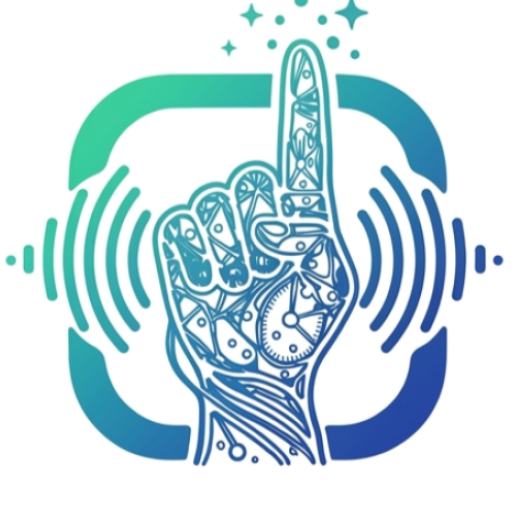

<div align="center">



# MotionSpeak

**An Offline-First Filipino Sign Language (FSL) Translator Mobile Application with Facial Emotion & Tone Recognition**

Translate Filipino Sign Language gestures and facial expressions into spoken and written words, entirely on-device.

[](https://developer.android.com/)
[](https://kotlinlang.org/)
[](https://developers.google.com/mediapipe)
[](https://www.tensorflow.org/lite)
[](https://react.dev/)
[](https://nodejs.org/)
[](https://fastapi.tiangolo.com/)
[](https://supabase.com/)

[Key Features](#-key-features) · [System Architecture](#-system-architecture) · [Installation and Setup](#-installation-and-setup) · [Usage Guidelines](#-usage-guidelines) · [Project Structure](#-project-structure)

</div>

---

## 📘 Project Overview

**MotionSpeak** is an assistive communication system bridging the gap between individuals who sign in Filipino Sign Language (FSL) and the hearing/non-signing community. By pairing real-time camera computer vision with on-device machine learning, MotionSpeak translates both hand gestures and facial expressions into clear text and natural synthesized speech in real time.

### Why MotionSpeak?
- **100% On-Device Translation**: Inference executes locally via TensorFlow Lite and Google MediaPipe. No internet connection is needed to translate signs, ensuring real-time response times, complete privacy, and reliability anywhere.
- **Emotion & Tone Awareness**: Sign language is multi-modal. MotionSpeak analyzes facial landmarks to classify emotional nuances (Neutral, Happy, Questioning, Surprised) and maps them to contextual speech inflection.
- **Adaptive Vocabulary**: The mobile app dynamically synchronizes newly trained gesture models and word definitions over-the-air (OTA) from the administrative platform.
- **LLM Sentence Synthesis Ready**: Built-in architecture designed to assemble raw sequential sign glosses and emotional tone into fluent, grammatically cohesive sentences.

---

## ✨ Key Features

### 📱 Mobile Application (`motionspeak-mobile/`)
- **Real-Time Translation Modes**:
  - **Live Mode**: Continuous sign recognition with dynamic gesture buffering and visual progress indicators.
  - **Tap Mode**: On-demand gesture capture for deliberate, single-sign recognition.
  - **Words & Letters**: Dedicated models for full sign vocabulary and fingerspelled alphabet.
- **Facial Emotion Recognition**: Multi-point facial expression detector running alongside hand tracking to detect expressiveness and tone.
- **Interactive UI with Siri Glow Meter**: Fluid, animated gradient progress meter indicating gesture buffer fullness and recognition confidence.
- **Floating Controls**: Quick-action buttons for flipping between front and rear cameras, copying output to clipboard, repeating speech, and clearing the message stream.
- **Offline Word Bank & Video Demonstrations**: Browse sign categories, search vocabulary, save favorites, and download demonstration videos for offline study.
- **Emergency SOS Alert**: Rapid 2-second press-and-hold audible alarm and visual prompt for immediate assistance.
- **Translation History**: Device-local log of recent translations with management and export capabilities.
- **Over-The-Air (OTA) Model Sync**: Automatically checks, validates SHA-256 checksums, and hot-swaps active TFLite models upon connection.

### 🖥️ Administrator Web Platform (`motionspeak-admin/`)
- **Signer & Dataset Management**: Upload sign videos categorized by signer ID, angle, and lighting conditions. Enforces dataset quality thresholds (e.g., minimum 20 approved samples across at least 4 signers per word).
- **Automated Feature Extraction**: Triggers landmark extraction pipeline across uploaded video datasets.
- **Model Training & Deployment**: Monitor model training metrics (accuracy, loss, confusion matrix), deploy new model versions, or revert to previous checkpoints with a single click.
- **Role-Based Access Control**: Secure superadmin and admin management with Brevo-powered email verification and password resets.
- **Audit Logs & PDF Reports**: Generate comprehensive operational activity reports and analytics.

### ⚡ Backend Server (`motionspeak-backend/`)
- **Robust REST API**: Orchestrates authentication, word bank metadata, model distribution, and media synchronization.
- **Secure File Storage**: Integrates with Supabase Storage buckets for gesture videos, demonstration clips, and `.tflite` model binaries.
- **Email Dispatch**: Brevo API integration for 6-digit OTP verification and account recovery.

### 🧠 ML Service (`motionspeak-ml/`)
- **Landmark Extraction**: Automated pipelines using MediaPipe Holistic/Hands/Pose to extract 3D spatial coordinate sequences.
- **Model Architectures**: Deep learning sequence classification models (LSTM / GRU / Bidirectional) optimized and quantized for mobile TFLite runtime.
- **Facial Expression Pipeline**: Real-time facial action unit analysis and emotion classification.

---

## 🏛️ System Architecture

```text
 ┌────────────────────────────────────────────────────────┐
 │                   MotionSpeak Mobile                   │
 │  (Kotlin · CameraX · MediaPipe · TensorFlow Lite)       │
 └───────────┬────────────────────────────────┬───────────┘
             │                                │
      On-Device Inference             Download Models / Sync
     (No Network Required)                    │
             │                                ▼
             │                    ┌───────────────────────┐
             │                    │    Backend REST API   │
             │                    │ (Node.js · Express)   │
             │                    └───────────┬───────────┘
             │                                │
             ▼                                ▼
     Real-Time Translation        ┌───────────────────────┐
     Text & Spoken Audio          │  PostgreSQL / Storage │
     + Emotion & Tone             │      (Supabase)       │
                                  └───────────┬───────────┘
                                              ▲
                       Train / Extract / Sync │
                                              ▼
 ┌───────────────────────┐        ┌───────────────────────┐
 │  Admin Web Dashboard  │───────►│       ML Service      │
 │  (React · Vite · CSS) │ Manage │  (Python · FastAPI)   │
 └───────────────────────┘        └───────────────────────┘
```

---

## 🎨 Design System & Theme

MotionSpeak features a high-contrast, accessible design palette tailored for readability and visual clarity:

| Swatch | Role | Hex | Purpose |
|---|---|---|---|
|  | **Brand Navy** | `#13306B` | Primary action buttons, mobile headers, and core identity |
|  | **Admin Blue** | `#1E3A8A` | Dashboard navigation, links, and secondary accents |
|  | **Light Tint** | `#EEF3FC` | Card surfaces, container tints, and highlighted sections |
|  | **Ink Text** | `#0F1B33` | Primary typography and icon color |
|  | **Tonal Dark** | `#0C1430` | Dark mode background and camera drawer surfaces |

---

## ⚙️ Installation and Setup

### Prerequisites

| Component | Minimum Version | Required For |
|---|---|---|
| **Node.js & npm** | Node 20.19+ or 22.12+ | Backend server, Admin Web platform |
| **Python** | 3.10 | ML Service |
| **Android Studio** | Ladybug / Hedgehog (SDK 34) | Mobile app (`minSdk 24`, Android 7.0+) |
| **Supabase Account** | PostgreSQL + S3-compatible Storage | Centralized database and file store |

---

### 1. Clone the Repository

```bash
git clone https://github.com/VMQ30/MotionSpeakLatest.git motionspeak
cd motionspeak
```

---

### 2. Database & Cloud Storage (Supabase)

1. Create a project in [Supabase](https://supabase.com).
2. Obtain your PostgreSQL connection string (`PG_URI`) and project API credentials (`SUPABASE_URL`, `SUPABASE_SERVICE_KEY`).
3. Create the required public storage buckets:
   - `videos` (Demonstration videos and training sample uploads)
   - `gesture-data` (Extracted landmarks and dataset files)
   - `models` (Compiled `.tflite` model packages and metadata)
4. Apply the SQL migrations in order from `motionspeak-backend/migrations/`:
   ```bash
   psql "$PG_URI" -f motionspeak-backend/migrations/001_model_versions_trained_word_ids.sql
   # Continue applying remaining numbered migrations sequentially
   ```

---

### 3. Backend Server

```bash
cd motionspeak-backend
npm install
cp .env.example .env
```

Configure your `.env` file:
```ini
PG_URI=postgresql://postgres:[PASSWORD]@[HOST]:5432/postgres
PORT=3000
JWT_SECRET=your_jwt_secret_key
JWT_EXPIRES_IN=7d
SUPER_ADMIN_USERNAME=superadmin
SUPER_ADMIN_PASSWORD=YourSecurePassword123!

# Email Service (Brevo)
BREVO_API_KEY=your_brevo_api_key
MAIL_FROM_EMAIL=no-reply@yourdomain.com
MAIL_FROM_NAME=MotionSpeak

# ML Service & Supabase
ML_SERVICE_URL=http://localhost:8000
ML_API_KEY=your_shared_ml_secret_key
SUPABASE_URL=https://your-project.supabase.co
SUPABASE_SERVICE_KEY=your_service_role_key
SUPABASE_BUCKET_VIDEOS=videos

# Dataset Thresholds
MIN_SIGNERS_PER_WORD=4
MIN_SAMPLES_PER_SIGNER=4
ALLOWED_ORIGINS=http://localhost:5173
```

Start the backend:
```bash
npm run dev
```

---

### 4. Machine Learning Service

```bash
cd motionspeak-ml
python -m venv venv

# Windows:
venv\Scripts\activate
# macOS/Linux:
# source venv/bin/activate

pip install -r requirements.txt
cp .env.example .env
```

Configure `motionspeak-ml/.env`:
```ini
SUPABASE_URL=https://your-project.supabase.co
SUPABASE_SERVICE_KEY=your_service_role_key
BACKEND_URL=http://localhost:3000/api
ML_API_KEY=your_shared_ml_secret_key
```

Download the required MediaPipe model assets into `motionspeak-ml/app/models/` following [`motionspeak-ml/app/models/README.md`](motionspeak-ml/app/models/README.md).

Start the FastAPI service:
```bash
uvicorn app.main:app --reload --port 8000 --host 0.0.0.0
```

---

### 5. Administrator Web Dashboard

```bash
cd motionspeak-admin
npm install
cp .env.example .env
```

Set `VITE_API_URL` in `.env`:
```ini
VITE_API_URL=http://localhost:3000/api
```

Start the Vite development server:
```bash
npm run dev
```
Access the dashboard at `http://localhost:5173`.

---

### 6. Mobile Application

1. Launch **Android Studio** and select **Open**, pointing to `motionspeak-mobile/`.
2. Ensure your Android SDK platform 34 and Build Tools are installed.
3. Configure the debug backend URL in `motionspeak-mobile/app/build.gradle.kts` if testing with a local backend:
   ```kotlin
   buildConfigField("String", "BASE_URL", "\"http://<your-computer-ip>:3000/api/\"")
   ```
4. Build and install on an emulator or physical device:
   ```powershell
   cd motionspeak-mobile
   .\gradlew.bat assembleDebug
   ```

---

## 🚀 Usage Guidelines

### Running the Full Local Stack

Open four terminal windows:

```bash
# Terminal 1: Backend API
cd motionspeak-backend && npm run dev

# Terminal 2: ML Pipeline & Training Service
cd motionspeak-ml && venv\Scripts\activate && uvicorn app.main:app --reload --port 8000

# Terminal 3: Admin Web Platform
cd motionspeak-admin && npm run dev

# Terminal 4: Android App Build / Logs
cd motionspeak-mobile && .\gradlew.bat installDebug
```

---

## 📂 Project Structure

```text
MotionSpeakLatest/
├── motionspeak-mobile/          # Native Android Application (Kotlin)
│   ├── app/src/main/kotlin/     # CameraX, TFLite Predictor, MediaPipe, UI Activities
│   ├── app/src/main/res/        # Layouts, vector drawables, themes, strings
│   ├── model_file_v1/           # Default offline TFLite model, labels, and metadata
│   └── tools/                   # App icon and asset generation utilities
├── motionspeak-admin/           # Administrator Web Dashboard (React + Vite)
│   ├── src/components/          # UI components, tables, modals, charts
│   ├── src/pages/               # Words, Signers, Models, Activity Logs, Reports
│   └── src/services/            # Axios API client integrations
├── motionspeak-backend/         # REST API Gateway (Node.js + Express)
│   ├── src/controllers/         # Auth, words, categories, models, signers
│   ├── src/models/              # Sequelize database models
│   ├── migrations/              # Incremental SQL migration scripts
│   └── server.js                # Express app entry point
├── motionspeak-ml/              # Machine Learning Engine (Python + FastAPI)
│   ├── app/api/                 # Training and extraction endpoints
│   ├── app/services/            # MediaPipe landmark extractors, TFLite exporters
│   └── tools/                   # Facial expression detection & dataset tooling
└── docs-internal/               # Architectural specs, diagrams, and sprint plans
```

---

## 🧪 Testing

```bash
# Backend unit & integration tests
cd motionspeak-backend
npm test

# ML service unit tests
cd motionspeak-ml
pytest

# Android unit tests
cd motionspeak-mobile
.\gradlew.bat testDebugUnitTest
```

---

<div align="center">

<sub>MotionSpeak · Filipino Sign Language translation for everyday communication</sub>

</div>
